<p align="center">
  
</p>

<p align="center">
  <a href="https://github.com/Moha2005269/agentgo/releases/latest/download/AgentGo-Setup.exe"></a>
</p>
<p align="center"><sub>One click downloads the installer. Run it and it sets everything up: no zip, no release page.</sub></p>

<p align="center">
  <a href="#install">Install options</a>
  &nbsp;·&nbsp; <a href="#benchmarks">Benchmarks</a>
  &nbsp;·&nbsp; <a href="#watch-an-agent-work">Watch it work</a>
  &nbsp;·&nbsp; <a href="#connect-your-agent">Connect your agent</a>
  &nbsp;·&nbsp; <a href="#security-and-privacy">Security</a>
  &nbsp;·&nbsp; <a href="#build-from-source">Build</a>
</p>

<p align="center">
  
  
  
  
  
</p>

---

## Benchmarks

One model, the same 37 tasks (23 BrowserGym MiniWoB++ tasks and 14 single-page
apps with late content, re-rendering and virtual lists, client-side routing
and optimistic updates), four browsers, all running at the same time. Each
task is a fresh agent session (gpt-6-luna through Factory's droid) that gets
only that browser's MCP tools; the page's own reward decides.

<p align="center">
  
</p>

| | Solved | Wrong actions | Median time | Input tokens per task | Agent turns per task |
|---|---:|---:|---:|---:|---:|
| **AgentGo 0.1.6 + GoMini v6** | **37/37** | **0** | **40 s** | **95k** | **7.8** |
| **AgentGo 0.1.6** | **37/37** | **0** | 41 s | 114k | 9.0 |
| browser-use 0.13.11 | 35/37 | 2 | 59 s | 306k | 17.5 |
| Playwright MCP 0.0.83 | 31/37 | 4 | 59 s | 227k | 14.5 |

form-sequence-2 is scored with "Then press Submit." added to its instruction,
for every browser; AgentGo's results are from the 0.1.6 release build.

What 0.1.6 fixed, measured on the same tasks before and after:

<p align="center">
  
</p>

Methods, every table and the tasks that failed:
[docs/benchmarks/agentgo-0.1.6.md](docs/benchmarks/agentgo-0.1.6.md),
[docs/benchmarks/agentgo-spa.md](docs/benchmarks/agentgo-spa.md) and, for
0.1.5, [docs/benchmarks/agentgo-0.1.5.md](docs/benchmarks/agentgo-0.1.5.md).

## A browser for you, and for the agent next to you

AgentGo is a real Chromium browser for Windows with no ads, no tracking and no accounts to create. It is also built so an AI agent (Claude Code, Codex, any MCP host or your own program) can use it the way a person would, while you watch and stay in charge.

AgentGo makes no model calls and needs no API key. Your agent does the thinking. AgentGo does the browsing, and answers in a few lines of text instead of a wall of HTML.

<table>
<tr>
<td width="50%" valign="top">

### Strong ad and tracker blocking
Brave's open-source blocking engine with **18 filter lists**: EasyList, EasyPrivacy, uBlock Origin, AdGuard, Peter Lowe, URLhaus, HaGeZi and more. It blocks requests, hides leftover page elements, runs scriptlets, strips YouTube ads at the network level and clears cookie banners. It is on by default and has a live counter. Public comparison benchmarks are coming; we will publish them when they are done.

</td>
<td width="50%" valign="top">

### A browser that fits you and your agent
The agent works with its own pointer and keyboard, drawn on the page and never your mouse, in a window that stays behind yours. You see every click and keystroke, and you can pause or stop it in one click. Everything else is a normal browser: tabs, bookmarks, history, downloads, and extensions from the Chrome Web Store, which run in Chromium's own extension engine (background workers, page scripts, network rules, pop-ups and options pages).

</td>
</tr>
<tr>
<td width="50%" valign="top">

### Security and fingerprint protection
Sandboxed renderers at untrusted integrity, per-session fingerprint noise, site permissions that stay blocked until you allow them, signed updates, DevTools gated, a prompt-injection scanner on page text, and an audit log that never records typed text or cookies. We aim to be one of the most secure and private browsers you can run. Independent benchmarks are coming.

</td>
<td width="50%" valign="top">

### Accounts for your agent, safely
Create accounts just for your agent, or let it use yours. Saved sign-ins are encrypted for your Windows user and **typed for the agent without it ever seeing the password**. Block any account in the Account Center, and the agent cannot touch it. Payments always ask you, in every mode. CAPTCHAs and one-time codes come to you in the same tab.

</td>
</tr>
<tr>
<td colspan="2" valign="top">

### GoMini, a model that knows the browser
> **GoMini is still in development.** v6 is a development release, not a finished model: use it for routine steps and let your agent check its work.

GoMini is a small model (322M parameters) trained on how this browser works. It runs on your computer (your graphics card through Vulkan when it can, else the processor) and takes the routine steps of a task, filling the values your agent supplies, clicking through, scrolling, so your agent hands over one subgoal instead of reading every page. It only picks between steps the browser offers; payments, sign-ins and final submissions always go back to your agent. Setup offers it (on by default, about 390 MB), or get it later in Settings > GoMini. GoMini v6, which 0.1.6 installs, finishes 53 of 65 held-out MiniWoB++ subgoals on its own (v5: 39, v4: 15) and picks the right step on 96.6% of held-out pages (v5: 76.6%); it says "done" falsely 4 times (v5: 3, v4: 26). Model: [huggingface.co/Mhmadhassnz/GoMini](https://huggingface.co/Mhmadhassnz/GoMini).

</td>
</tr>
</table>

## Watch an agent work

<p align="center">
  
</p>

The agent never reads raw HTML. It gets a short outline with numbered references, and every action answers with only what changed. That is why the demo page costs **186 tokens instead of about 42,000**.

```text
observe.page →
# Sign in to check out
[1] textbox(email) "Email" required
[2] textbox(password) "Password" required
[3] checkbox "Keep me signed in"
[4] button "Continue"

act.fill {ref: 1, text: "…"} →
~ [1] textbox(email) value="…"
```

## Everyday browsing, done well

- **Command palette** (Ctrl+K): search settings, tabs, history, bookmarks and actions.
- **First-run welcome and import** of history, bookmarks, saved passwords and open tabs from Chrome, Edge, Brave and Firefox, plus password CSV files.
- **Make it yours**: accent colour, light/dark/system theme, page text size, six search engines or your own search address, a home page, a favorites bar and the toolbar buttons you want.
- **Dark mode for websites** with brightness and contrast sliders and a per-site exclusion list.
- **Translation** of a selection or a whole page into the language you pick (Settings → Languages).
- **Site permissions that ask**: camera, microphone and location are blocked until you choose *Allow this time* or *Always allow*, and you can block a site again any time.
- Favorites bar, find in page, zoom, print and print to PDF, session restore, tab groups, pinned tabs, several windows.
- **Report a problem** saves a diagnostics zip on your machine. Nothing is sent anywhere.

## Install

<p>
  <a href="https://github.com/Moha2005269/agentgo/releases/latest/download/AgentGo-Setup.exe"></a>
  &nbsp;
  <a href="https://github.com/Moha2005269/agentgo/releases/latest/download/AgentGo-Setup-full.exe"></a>
</p>

**AgentGo Setup** (recommended). Click the blue button: it downloads `AgentGo-Setup.exe` straight away. Run it. A small card floats onto your desktop and unfolds into the installer: accept the license, pick a folder, shortcuts and PATH, connect Claude Code, Codex or Droid in one click, choose theme, search engine and privacy settings, then bring over bookmarks, history, passwords and open tabs from Chrome, Edge, Brave or Firefox. It installs for your Windows user only (no administrator rights), checks the download against its published SHA-256 and every file against `SHA256SUMS.txt`, and adds an uninstaller to *Settings, Apps*.

- No internet on the target PC? Use [`AgentGo-Setup-full.exe`](https://github.com/Moha2005269/agentgo/releases/latest/download/AgentGo-Setup-full.exe), which carries the browser inside.
- Deploying to many PCs? `AgentGo-Setup-full.exe --silent` installs with the defaults (privacy and security on) and no window; add `--dir <folder>`, `--no-shortcuts`, `--no-path` or `--no-agents`. `--uninstall --silent [--remove-profile]` removes it. The log is `%TEMP%\agentgo-setup.log`; the exit code is 0 on success.
- Prefer a folder? Download `AgentGo-<version>-win64.zip`, unzip it anywhere and run `agentgo.exe`. `Install-AgentGo.ps1` inside it does the Start-menu entry, PATH and Claude Code registration from a terminal (`-Uninstall` removes it).

Your profile (history, bookmarks, cookies, saved sign-ins) lives under `%LOCALAPPDATA%\AgentGo`. Every release file is signed with [Sigstore Cosign](https://www.sigstore.dev/) (the `.sigstore.json` file next to it; how to check it: [docs/verify-release.md](docs/verify-release.md)). The executables are not Authenticode-signed yet, so Windows SmartScreen may still ask once.

## Connect your agent

```powershell
claude mcp add --scope user agentgo -- C:\path\to\agentgo.exe mcp   # Claude Code, every project
agentgo.exe call observe.page                              # any shell
agentgo.exe run --stdio                                    # programs: JSON lines
```

Agents should read `skills/agentgo/SKILL.md` first (over MCP: `browser_guide`). Every command is listed in `skills/agentgo/references/commands.md`. `agentgo setup claude|codex|droid|json` registers AgentGo with an agent host for you (Setup does this too). Checked with each host's own health check: `claude mcp list`, `codex mcp get agentgo` and `droid mcp list` all report it connected.

## Security and privacy

- **No telemetry, no ads, no accounts.** AgentGo does not phone home. What it connects to is documented in [`docs/NETWORK_CALLS.md`](docs/NETWORK_CALLS.md).
- **Sandboxed**: web pages render in untrusted-integrity processes (CEF `bootstrap.exe` + `agentgo.dll`).
- **Fingerprint protection that knows who is browsing**: while you browse, canvas, WebGL and audio read-backs get noise that changes every session and differs per site, so nothing links your visits. When an agent connects, the browser switches to the agent's own fingerprint: unique to your install, the same on every site and across restarts, and never the same as yours, so an agent's visits can't be tied to you and sites see one consistent visitor. The protection reads as native code and also covers blank iframes, popups and offscreen canvases.
- **Dangerous sites stopped at the door**: before any page loads, AgentGo checks it against 35,000+ known malware and phishing sites and looks for imitations no list knows yet: look-alike letters from other alphabets, `paypal.com.verify-account.top`-style addresses and brand-plus-"login" domains. All on your computer: no address is ever sent to Google or anyone else. Agents can never click past the warning.
- **Private by default**: third-party cookies blocked, tracking parameters (`fbclid`, `gclid`, `utm_*` ...) stripped from links, the Global Privacy Control signal sent, plain http upgraded to https, notifications refused.
- **WebRTC**: pages only ever learn your public address; private networks and VPN adapters stay hidden.
- **Checked against public testers** (`security_live_e2e`): badssl.com certificate errors 5/5 blocked, adblock-tester.com 100/100, EFF Cover Your Tracks "strong protection against Web tracking".
- **You stay the admin**: payments always ask, CAPTCHAs are handed to you (never solved), every action is logged locally, and typed text and cookie values never enter the log.
- **Signed automatic updates**: new releases install themselves when you close AgentGo, only when signed with the release key (Ed25519) and matching their SHA-256. Turn it off in Settings and an Update button appears instead.
- **Prompt-injection scanner**: page text given to an agent is checked for instructions aimed at the agent.
- **How each claim is tested**: [`docs/SECURITY_TESTING.md`](docs/SECURITY_TESTING.md). Threat model: [`docs/threat-model.md`](docs/threat-model.md). Report a vulnerability: [`SECURITY.md`](SECURITY.md).

## Honest limits

- Windows 11 x64 only.
- The ad blocker and security claims above come from our own testing. Independent benchmarks against other browsers are not published yet.
- The agent benchmark above is our own run: one model, one run per task and browser, on MiniWoB++ pages served locally. The method and every result are in the benchmark notes, so you can repeat it.
- Chrome seals its newest passwords (app-bound encryption) so only Chrome can read them. The import says how many, opens Chrome's export page for you and takes the CSV it saves. Firefox passwords import only when no primary password is set.
- Translation uses Google's translation service. Notifications are refused for every site. There is no VPN in this release.
- Extensions run in Chromium's own extension engine, but its tab APIs see only one tab per window while AgentGo shows many: calls that address a tab by id from an extension's background (`tabs.sendMessage`, `scripting.executeScript`) do not reach AgentGo's tabs yet, so extensions built on them (Dark Reader) apply partly. An extension installed or turned on while AgentGo runs is fully on after a restart.
- Cross-origin iframes are not observed or acted in.
- GoMini is still in development (v6 is a development release). It is trained and checked on AgentGo's own forms, single actions and navigation; on arbitrary sites it is not proven yet, and its confidence is not calibrated. That is why every step it picks is checked by the browser, sensitive steps go back to your agent, and "done" is a claim your agent can verify.
- Real Google, GitHub and Yandex API sign-in has not been tried live; the OAuth flow is tested against a mock provider.

## Build from source

```powershell
powershell -ExecutionPolicy Bypass -File scripts\bootstrap.ps1 -Stage toolchain
powershell -ExecutionPolicy Bypass -File scripts\build.ps1 -Runtime -Release              # tools
powershell -ExecutionPolicy Bypass -File scripts\build.ps1 -Runtime -Sandbox -Release     # sandboxed browser
powershell -ExecutionPolicy Bypass -File scripts\package.ps1 -Release
```

Installers: `powershell -File scripts\build-installer.ps1` writes `dist\AgentGo-Setup.exe` and, from the newest package zip, `dist\AgentGo-Setup-full.exe` (source in `installer/`).

Tests: `cargo test --workspace --offline` and `node scripts\dev\run-integration.js` (end-to-end files on a private desktop; `--live` adds public sites, including the security testers in `security_live_e2e`). Engine: CEF 152 (Chromium 152.0.7977.54), pinned and hash-verified; Rust 1.98.1 MSVC; cef-rs pinned by commit.

Layout: `crates/` (Rust workspace), `ui/` (browser chrome and panels), `skills/agentgo/` (the agent's guide), `tests/integration/`, `docs/`.

## Why we built it, and thank you

We do not care about ads, and we do not care about your data. AgentGo is not built for profit and nothing here is designed to make money from its users. It is built for humanity, on the shoulders of decades of open-source work.

Thank you to:

- **Brave** for [adblock-rust](https://github.com/brave/adblock-rust) and [adblock-resources](https://github.com/brave/adblock-resources), the engine behind our blocker.
- **The Chromium project and the CEF team** (Marshall Greenblatt and contributors), and **Tauri** for [cef-rs](https://github.com/tauri-apps/cef-rs).
- **Raymond Hill and the uBlock Origin community**, **EasyList and EasyPrivacy**, **AdGuard**, **Peter Lowe**, **abuse.ch (URLhaus)** and **HaGeZi** for the filter lists, and **malware-filter** with **OpenPhish**, **PhishTank** and **IPThreat** for the phishing data.
- **Dark Reader** (MIT) and **Fuse.js** (Apache-2.0).
- **The Rust community** and every crate author we depend on. The full list is in [`NOTICE.md`](NOTICE.md), [`third_party/`](third_party/) and [`docs/licenses.md`](docs/licenses.md).

## License

AgentGo is released under the **Business Source License 1.1** (see [`LICENSE`](LICENSE)). You may use, copy, modify and redistribute it for non-commercial, evaluation, development, research and personal purposes. Production use by a commercial entity or for commercial purposes needs a commercial license from the author. On **2030-01-01** (or four years after the first public release of a version, whichever comes first) each version converts to the **Apache License 2.0**. Third-party components keep their own licenses.

The MCP server and the protocol it speaks are **MIT** licensed: `crates/agentgo-mcp`, `crates/agentgo-protocol`, `crates/agentgo-policy`, `crates/agentgo-shell-bridge` and the agent guide in `skills/agentgo` (each has its own `LICENSE`). They are also published on their own as [agentgo-mcp](https://github.com/Moha2005269/agentgo-mcp).