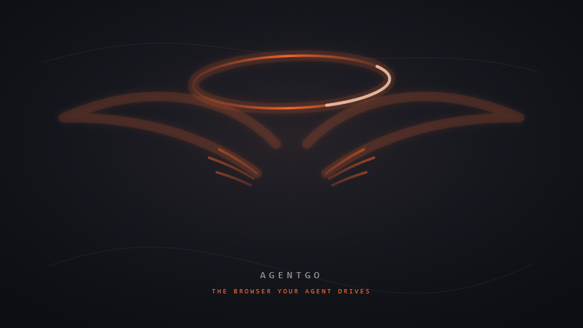
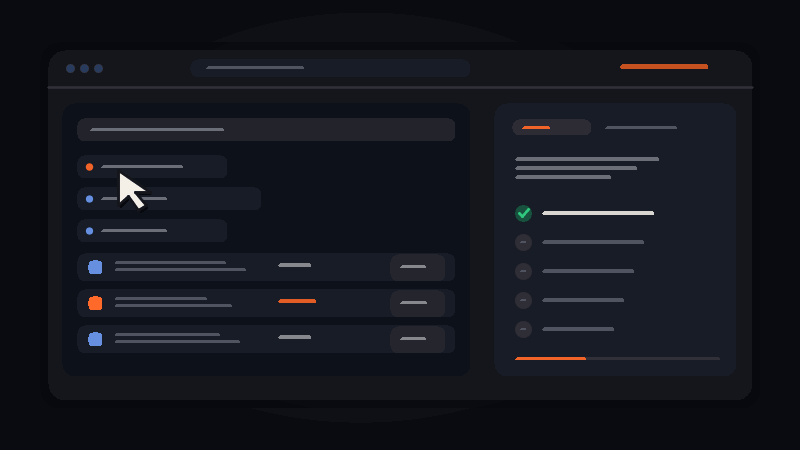
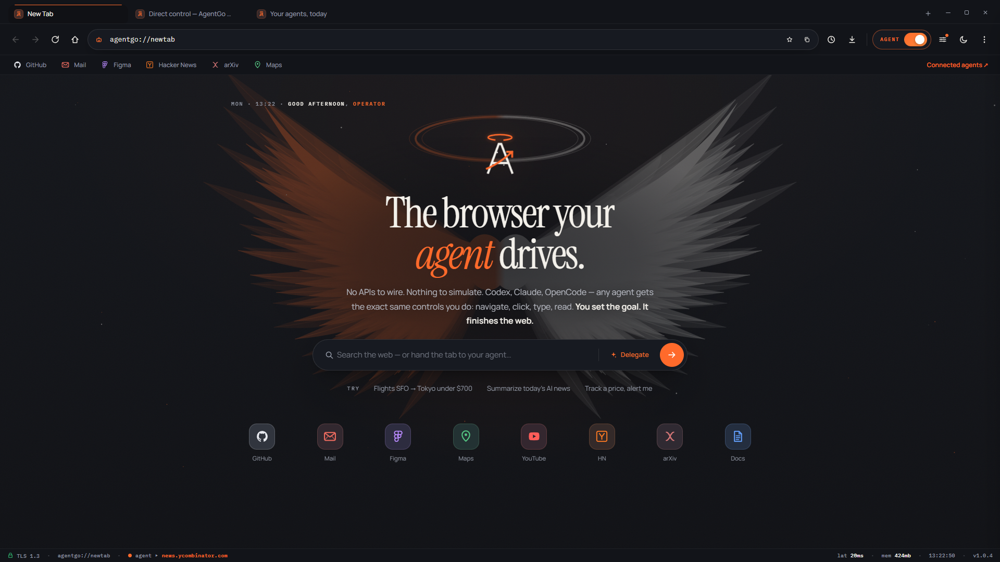
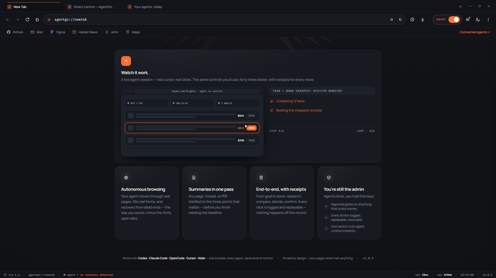

<div align="center">
  
  <h1>AgentGo</h1>
  <p><strong>The browser your agent drives.</strong></p>
  <p>A Windows-first, local, agent-centric browser surface designed to give Codex, Claude Code, OpenCode, and other agents the same control a human has — with better context, safer execution, and fewer tokens.</p>

  <p>
    
    
    
    
    
    
  </p>
</div>

<p align="center">
  
</p>

> AgentGo is being built around one uncompromising idea: the browser should be a first-class control surface for agents, not a tab-shaped API wrapper that makes the agent fight the web.

## Why AgentGo?

Browser automation usually forces an agent to choose between two bad extremes: a brittle click script that cannot understand a changing page, or a huge stream of screenshots and raw HTML that burns context while still missing the important state.

AgentGo is meant to give an agent a compact, truthful picture of the page and the ability to act on it directly. The agent can inspect the DOM, accessibility tree, layout, HTML, screenshot, and browser state; choose the smallest useful representation; then click, type, scroll, drag, upload, download, navigate, verify, and recover through one consistent control surface.

<p align="center">
  
</p>

<p align="center"><sub>Observe the page. Make the move. Verify the result.</sub></p>

The user remains in charge of credentials, CAPTCHA handoffs, purchases, destructive actions, and the emergency controls. Everything else can be automated when the user chooses Full Access mode.

## The core promise

**Any agent. The same browser. The same controls.**

AgentGo is designed to be launched by the agent or by the user, then controlled through a local, tool-neutral bridge. A Codex task, Claude Code session, OpenCode workflow, or a custom local agent should not need a different browser integration for basic web work.

The browser ships with its own `AgentGo Skill`: a compact operating manual that teaches agents how to observe, act, verify, pause, recover, and ask for human help. The skill is part of the product architecture, not documentation bolted on at the end.

## What it is designed to do

<table>
  <tr>
    <td width="33%"><h3>Human-parity control</h3><p>Mouse, keyboard, tabs, windows, forms, menus, pop-ups, dialogs, file pickers, downloads, media controls, zoom, find, print, and page navigation.</p></td>
    <td width="33%"><h3>Agent-grade context</h3><p>DOM, HTML, accessibility semantics, geometry, screenshots, visible text, focused state, browser events, compact deltas, and stable element references.</p></td>
    <td width="33%"><h3>One-call workflows</h3><p>Search, filter, paginate, extract, compare, fill, upload, verify, collect evidence, and return structured results without replaying every tiny action through the model.</p></td>
  </tr>
  <tr>
    <td><h3>Human control</h3><p>Approval and Full Access modes, smooth pause/resume, a visible red Stop Agent control, action history, checkpoints, and a hard gate on purchases.</p></td>
    <td><h3>Local isolation</h3><p>Separate browser instances, profiles, storage, random instance identifiers, parallel sessions, and local-only communication so one agent’s state does not bleed into another.</p></td>
    <td><h3>Evidence, not vibes</h3><p>Screenshots, HTML, page snapshots, downloads, traces, action results, hashes, and replayable records make the result inspectable instead of magical.</p></td>
  </tr>
</table>

## Capability map

The complete capability inventory is kept in [`docs/capability-inventory.md`](docs/capability-inventory.md). The short version is below.

<details>
<summary><strong>Everyday browser surface</strong></summary>

- Launch the browser from an agent or let a user launch it and hand over a window or tab.
- Create, focus, rename, reorder, duplicate, move, reload, close, and inspect tabs.
- Manage windows, pop-ups, modal dialogs, downloads, print flows, permissions, find-in-page, zoom, fullscreen, and navigation history.
- Navigate to URLs, follow links, go back and forward, refresh, stop loading, wait for network or visible state, and recover from common page failures.
- Use mouse movement, click, double-click, right-click, hover, drag, drop, wheel scrolling, touch-like gestures, keyboard shortcuts, text entry, selection, copy, paste, and clipboard operations.
- Upload files through real file pickers and inspect download state without pretending that a download happened.
- Work with forms, selects, checkboxes, radios, content-editable controls, rich editors, iframes, shadow roots, and dynamically rendered interfaces.

</details>

<details>
<summary><strong>What the agent can see</strong></summary>

- A compact semantic page outline with roles, names, values, states, and actionable controls.
- The accessibility tree for reliable intent-based targeting.
- DOM and HTML when structural detail is required.
- Element geometry, viewport state, scroll position, focus, selection, z-order hints, and hit-test information.
- A screenshot or cropped visual region when appearance, canvas content, charts, or visual confirmation matters.
- Incremental changes after an action so the agent does not need a fresh full-page dump for every step.
- Structured extraction from tables, lists, product cards, job postings, articles, PDFs, and search results.
- Optional OCR or vision-assisted interpretation as a targeted fallback, not the default representation for every page.

</details>

<details>
<summary><strong>What the agent can do</strong></summary>

- Search and browse, filter and sort, open result sets, compare candidates, paginate, and collect structured records.
- Fill forms from visible fields, validate required inputs, handle multi-step flows, and report exactly what remains.
- Read and summarize pages, threads, documents, and PDFs while preserving source links and evidence handles.
- Create a verified batch of actions, execute it with checkpoints, and return a compact result rather than narrating every click.
- Retry safe actions, refresh and repair stale state, detect navigation changes, and ask for a better observation when the page is ambiguous.
- Save or hand back screenshots, downloaded artifacts, extracted data, traces, and replayable action records.
- Let an external agent remain the planner while AgentGo owns the browser mechanics, verification, and compact state transitions.

</details>

<details>
<summary><strong>Safety and human handoff</strong></summary>

- **Approval Needed mode:** the agent can inspect and prepare work, but sensitive actions wait for the user.
- **Full Access mode:** the agent can operate continuously after the user enables it, while hard safety boundaries remain active.
- Credentials are only requested when they are not already stored or available through an approved autofill path.
- The agent can trigger autofill when permitted, but does not silently invent or exfiltrate credentials.
- CAPTCHA and bot-verification screens trigger a smooth Windows notification asking the user to help; the agent resumes after the page is usable.
- Purchases, checkout, money movement, and other cost-bearing commits always keep an approval gate, even in Full Access mode.
- Pause temporarily suspends work so the user can fix or explain something. Stop Agent cancels the current request and is visually distinct, red, and immediate.
- Every important action is logged, attributable to an isolated instance, and designed to be reviewable and recoverable.
- Optional settings can allow or deny downloads, external access, autofill, screenshots, OCR, and other higher-risk capabilities.

</details>

## Token-efficient by design

AgentGo is focused on reducing the amount of browser state an agent must carry in its context. The browser does more mechanical work locally and returns handles, deltas, and structured results.

| Expensive loop | AgentGo approach |
| --- | --- |
| Re-send a full screenshot after every click | Return a semantic state summary plus the changed region or targeted crop |
| Make the model rediscover the same button | Keep stable references tied to the current page state and invalidate them when necessary |
| Stream raw HTML for a simple question | Run a local extractor and return the relevant structured fields with evidence handles |
| Narrate 30 clicks for a repetitive workflow | Submit a verified batch with checkpoints, progress, and a compact result record |
| Push a huge PDF or download into context | Keep the artifact local and return metadata, pages, excerpts, and a path/handle |
| Use vision as the default for every page | Use DOM and accessibility data first; request pixels when visual information is genuinely needed |
| Let every integration invent its own browser vocabulary | Teach one shared AgentGo Skill and one consistent local protocol |

The target is not “fewer observations at any cost.” The target is **the smallest truthful observation that lets the agent make the next correct decision**.

## AgentGo Skill

The browser is intended to ship with a skill that other agents can read and use fluently. It will cover:

1. Launching or attaching to an isolated instance.
2. Choosing a compact observation: semantic, DOM, HTML, screenshot, crop, or artifact.
3. Targeting elements by intent and stable reference instead of fragile coordinates whenever possible.
4. Batching safe actions and verifying state after each meaningful transition.
5. Handling stale pages, loading states, redirects, pop-ups, dialogs, downloads, and file pickers.
6. Calling `pause`, `resume`, and `cancel` correctly.
7. Recognizing login, CAPTCHA, purchase, permission, and destructive-action boundaries.
8. Returning structured results with evidence instead of a transcript of clicks.
9. Reducing context by asking only for the next useful page state.
10. Recovering from failures and asking the user a precise question when human input is truly required.

This makes AgentGo portable across agent hosts: the browser stays the same while the planner can change.

## Architecture direction

```text
┌─────────────────────────────────────────────────────────────────────┐
│ Agent host: Codex · Claude Code · OpenCode · custom local agent      │
└──────────────────────────────┬──────────────────────────────────────┘
                               │ AgentGo Skill + local protocol
┌──────────────────────────────▼──────────────────────────────────────┐
│ AgentGo bridge: observe · act · batch · verify · pause · recover     │
│ compact snapshots · deltas · stable refs · artifacts · action log    │
└──────────────┬───────────────────────────┬──────────────────────────┘
               │                           │
       local named pipe / stdio       structured evidence store
               │                           │
┌──────────────▼───────────────────────────▼──────────────────────────┐
│ Isolated AgentGo instance                                             │
│ Windows shell · browser UI · tabs · windows · profiles · CEF surface │
└──────────────────────────────┬──────────────────────────────────────┘
                               │
                    real websites and web apps
```

The browser is the control surface. It is not meant to hide the agent behind a private cloud API, require a proprietary account, or force every agent ecosystem to implement a different integration.

The workspace motion plate in the explanation section above is a visual translation of the UI prototype’s **Watch it work** section: a cursor moves through a live-looking browser workspace, clicks a result, and advances the verification record. It is an illustration of the interaction model, not a claim that the pictured site is being controlled by this README.

## Planned developer flow

The interface below describes the direction of the local protocol. It is intentionally readable by humans and easy for an agent skill to generate.

```jsonl
{"op":"browser.launch","mode":"approval","profile":"research"}
{"op":"tab.navigate","url":"https://example.com/jobs"}
{"op":"page.observe","views":["semantic","visible","delta"]}
{"op":"agent.search_and_extract","query":"senior product designer","fields":["title","company","location","url"]}
{"op":"workflow.verify","require":"user-visible-evidence"}
{"op":"agent.pause","reason":"Please review the prepared result set"}
{"op":"agent.resume"}
{"op":"agent.cancel"}
```

The final wire format, error taxonomy, policy engine, session model, and SDKs are documented in the implementation plan as the build advances. See [`docs/implementation-plan.md`](docs/implementation-plan.md).

## Project status

AgentGo is an active research and implementation project. The visual direction is established; the Windows-first browser architecture, local protocol, policy boundaries, session isolation, artifact model, tests, and skill scaffolding are being built in milestones.

This README is intentionally honest: the product goal is ambitious, but the browser is not being presented as production-ready before the hard parts are proven.

### Roadmap (Milestones)

| Milestone | Status | Focus | Target Outcome |
| :---: | :---: | :--- | :--- |
| **0** | ✅ **Done** | Workspace & Architecture | 15 Rust crates, toolchain pins, invariant tests, capability manifest |
| **1** | 🔄 *In progress* | CEF Engine & Surface | Native CEF subprocess model, headed browser window, tab lifecycle |
| **2** | 📋 *Planned* | Windows Native Harness | Native file-picker dialogs, OS prompts, foreground/background control |
| **3** | 📋 *Planned* | Local Protocol & Bridge | Windows named pipes / stdio, cryptographic session isolation |
| **4** | 📋 *Planned* | Semantic Context Reducer | Outline views, intent filtering, structural deltas, stable element references |
| **5** | 📋 *Planned* | Batch Workflow Engine | One-call multi-step flows, auto-wait, local verification checkpoints |
| **6** | 📋 *Planned* | Safety & Policy Engine | Approval vs Full-Access modes, hard purchase gates, Stop Agent button |
| **7** | 📋 *Planned* | Human Handoff Relay | In-place CAPTCHA & 2FA pause with native Windows notifications |
| **8** | 📋 *Planned* | Evidence & Artifact Store | Local artifact persistence, sha256 evidence handles, secret redaction |
| **9** | 📋 *Planned* | AgentGo Skill & MCP | Shared cross-agent skill, MCP server, Claude Code / Codex adapters |
| **10** | 📋 *Planned* | Complete Browser Surface | Tabs, sessions, history, downloads, DevTools, extension management |
| **11** | 📋 *Planned* | Hardening & Benchmarks | BrowserGym evaluation, security audit, fuzz testing, release candidate |

*Current Progress: Milestone 0 completed — 11 milestones remaining.*

## Visual prototype & interface preview

The GitHub README is the canonical project story. AgentGo includes a comprehensive visual interface prototype ([`agentgo-ui.html`](agentgo-ui.html)) and a local presentation page ([`showcase.html`](showcase.html)).

```text
Open showcase.html or agentgo-ui.html in a modern browser
```

### New Tab & Agent Omnibar

The landing surface combines quick access shortcuts, ambient agent status, and an omnibar designed to either search or delegate the tab directly to Codex, Claude Code, or OpenCode:

<p align="center">
  
</p>

### Autonomous execution ("Watch it work")

AgentGo handles multi-step browsing sessions with real cursor interaction, verification checkpoints, and receipts for every move:

<p align="center">
  
</p>

## Repository layout

```text
.
├── README.md
├── showcase.html                  # local visual preview of the README story
├── agentgo-ui.html                 # interactive UI prototype
├── assets/
│   ├── agentgo-logo.svg            # source logo
│   ├── agentgo-loop.svg            # animated vector source
│   ├── agentgo-loop.gif            # GitHub-compatible motion asset
│   ├── agentgo-workspace.gif        # cursor + click + verification motion asset
│   ├── agentgo-ui-home.png         # 1920x1080 New Tab UI preview
│   └── agentgo-ui-watch-it-work.png # 1920x1080 autonomous session UI preview
├── docs/
│   ├── capability-inventory.md
│   └── implementation-plan.md
└── tools/
    ├── build-gif.js                # dependency-free wing/halo GIF renderer
    ├── build-ui-gif.js              # dependency-free workspace GIF renderer
    └── render-svg-gif.py            # Chromium-accurate SVG-to-GIF renderer
```

## Contributing

AgentGo benefits from contributors who care about both agent capability and human trust. Useful contributions include:

- Windows input, windowing, dialog, and file-picker fixtures.
- Accessibility-tree and DOM snapshot reduction strategies.
- Deterministic browser workflows with clear verification points.
- Token and latency benchmarks for real pages.
- Security review of profiles, credentials, downloads, IPC, and isolation.
- CAPTCHA handoff UX that respects the user without encouraging bypasses.
- Cross-agent skill examples for Codex, Claude Code, OpenCode, and local runtimes.
- Documentation, test pages, failure cases, and reproducible bug reports.

Please avoid submitting stealth, credential theft, CAPTCHA bypass, spam, or policy-evasion features. AgentGo should make legitimate automation more capable and more accountable.

## Security principles

AgentGo is local-first by design. Sensitive state should remain in the user-controlled machine, instance boundaries should be explicit, logs should avoid secrets, and risky actions should be visible and gated. A browser that can act like a human must also make it easy for a human to see what happened and take control back.

If you discover a security issue, do not publish credentials, cookies, session data, or private URLs in an issue. Use the project’s private security channel once the repository’s disclosure process is established.

## License

AgentGo is licensed under the [Business Source License 1.1 (BSL 1.1)](LICENSE).

- **Personal & Non-Commercial Use**: You are free to run, modify, inspect, and evaluate AgentGo for personal, research, and non-commercial development.
- **Commercial Use**: Any use in production, deployment by a commercial entity, or for commercial purposes requires a commercial license agreement from the Licensor.
- **Open Source Transition**: On the Change Date (2030-01-01), the software automatically converts to the **Apache License, Version 2.0**.

<div align="center">
  <br />
  <a href="#agentgo" title="Back to top">
    
  </a>
  <br /><br />
  <sub>AgentGo — less browser theater, more finished work.</sub>
</div>
