# AgentGo 0.1.5 benchmarks

Everything here compares AgentGo 0.1.4 with 0.1.5 on the same machine
(Windows 11, Ryzen, RX 7800 XT), home connection, 2026-10-20 and 21. Pages are
BrowserGym's MiniWoB++ tasks (browsergym-miniwob 0.14.3), served locally with
BrowserGym's own start-up (seeded problem, display removed, long timer); a
task's reward is the page's own. GoMini runs on the GPU through Vulkan.

## 1. What the agent sees (130 MiniWoB++ pages, no model)

For every MiniWoB++ page, the clickable elements a person can use (native
controls plus elements with their own click/mousedown listener, from
Chromium's DevTools) are compared with AgentGo's outline after
`browser_open`.

| | 0.1.4 | 0.1.5 |
|---|---:|---:|
| Pages | 130 | 130 |
| First outline is the empty starting page | 130 | 0 |
| Pages with no control in the outline | 13 | 0 |
| Controls listed (DevTools finds 749 elements with a listener or native role) | 496 | 914 |
| Named elements DevTools finds that the outline does not list | 128 | 77 |
| `browser_open` time, mean / median (ms) | 2,248 / 2,124 | 2,673 / 2,294 |

0.1.4 answered `browser_open` before the page's load handlers ran, so every
first outline was MiniWoB++'s empty starting page. 0.1.5 waits until the page
is still (at most 0.8 s more), which is most of the extra 170 ms at the
median. The outline lists more lines than DevTools' count because a row and
the parts of it a person can press separately (an email's sender, subject
and icons) are each listed. Most of the 77 elements left are words inside a
listed row that the row's own click handles (DevTools reports a listener on
each word); the rest are mostly drag handles and canvas parts.

## 2. Setting values (one test page, 25 field kinds)

Each field gets one `act.fill`, `act.select`, `act.check` or `act.type`; the
page records the value it saw and the events that fired.

| | 0.1.4 | 0.1.5 |
|---|---:|---:|
| Cases passed: 24 field kinds (text, password, email, number, tel, url, search, date, time, datetime-local, month, week, colour, range, textarea, select lists, checkbox, radio buttons, a script-controlled input and others) and typing into a terminal-like box that listens for keys | 15 / 25 | **25 / 25** |

Date, time, month, week, colour and range fields took no value from
`act.fill` in 0.1.4; `act.type` ignored `ref` and sent no key events.

## 3. Real websites (20 sites, first visit, read-only)

`browser_open`, then `browser_read` 1.5 s later. No sign-in, nothing
submitted.

| Site | Controls in the `browser_open` reply, 0.1.4 | 0.1.5 | Open time 0.1.4 (ms) | 0.1.5 (ms) |
|---|---:|---:|---:|---:|
| en.wikipedia.org | 146 | 146 | 3,216 | 3,057 |
| bbc.com | 112 | 112 | 3,469 | 3,214 |
| github.com | 134 | 135 | 4,715 | 4,562 |
| news.ycombinator.com | 150 | 150 | 3,738 | 3,255 |
| reddit.com | 131 | 139 | 4,958 | 4,740 |
| stackoverflow.com | **0** | 132 | 4,519 | 4,476 |
| amazon.com (search) | 4 | 4 | 3,179 | 2,655 |
| booking.com | **0** | 117 | 3,109 | 3,917 |
| youtube.com | 34 | 35 | 7,014 | 5,324 |
| nytimes.com | 144 | 146 | 4,322 | 5,522 |
| imdb.com (Top 250) | **0** | 149 | 4,079 | 10,175 |
| developer.mozilla.org | 144 | 142 | 4,782 | 4,490 |
| w3schools.com | 142 | 142 | 3,341 | 3,034 |
| espn.com | 125 | 114 | 7,154 | 4,661 |
| weather.gov | 70 | 70 | 5,151 | 5,772 |
| craigslist.org | 133 | 149 | 8,603 | 4,271 |
| etsy.com | **0** | human check handed to the person | 3,790 | 3,149 |
| aljazeera.com | 121 | 125 | 3,489 | 2,888 |
| huggingface.co | 131 | 131 | 3,884 | 3,540 |
| google.com (search) | human check | 78 | 3,622 | 4,299 |

0.1.4 answered four first visits with an empty page: the one a browser check
(Cloudflare, AWS WAF, DataDome) left behind. 0.1.5 reads the real page once
the check passes, and hands a check that stays (Etsy's DataDome captcha) to
the person. Amazon's search page shows 4 controls in both versions: Amazon
answered this connection with a short block page (236 characters of text). Median open
time: 3,981 ms (0.1.4), 4,285 ms (0.1.5), most of the difference being the
checks 0.1.5 now waits out (IMDb). Unnamed controls on these 20 pages: 68
(0.1.4), 26 (0.1.5).

## 4. GoMini delegations (13 held-out MiniWoB++ task types x 5 seeds)

Each task's instruction becomes one `browser_delegate` subgoal, written the
way `references/gomini.md` asks. A final Submit is the planner's, so the
script presses it after a delegation that says done. The page's reward says
whether the delegation did its part. None of these pages were used to train
GoMini.

| Task | 0.1.4 + GoMini v4 | 0.1.5 + GoMini v5 |
|---|---:|---:|
| click-button | 4/5 | 4/5 |
| click-link | 5/5 | 4/5 |
| click-option | 0/5 | 4/5 |
| click-checkboxes | 0/5 | 5/5 |
| click-tab-2 | 2/5 | 2/5 |
| enter-text | 0/5 | 5/5 |
| focus-text | 0/5 | 0/5 |
| choose-list | 0/5 | 5/5 |
| enter-date | 0/5 | 5/5 |
| navigate-tree | 4/5 | 5/5 |
| click-collapsible | 0/5 | 0/5 |
| social-media | 0/5 | 0/5 |
| form-sequence-2 | 0/5 | 0/5 |
| **Solved** | **15/65** | **39/65** |
| False "done" (GoMini said done, the page did not count it) | 26 | **3** |
| Median time per delegation (ms) | 2,236 | 2,649 |

Where v5 still fails: it says it has no step for "focus the text box"
(focus-text) and for opening a collapsed section (click-collapsible), kinds
of step it was never trained on; on form-sequence-2 it does not map "the 3rd
radio button" to `radio "3 of 3"`; on click-tab-2 it clicked a wrong link in
3 of 5 seeds (2 of its 3 false "done"); social-media's icons ignore a real
mouse click on this page. The third false "done" is click-button seed 201: it
pressed a "No" button and the page scored -1.

## 5. An agent using each browser (four setups, one model)

One model drives every browser: **gpt-6-luna** (medium reasoning) through
Factory's `droid exec`, a fresh session for every task, so nothing is
remembered between tasks or setups. Each session gets only that browser's MCP
tools (text tools: no screenshots, no page script) and the server's own
instructions, and the same prompt: the task's URL and its BrowserGym
instruction. The page's own reward decides; tokens, turns and time are
droid's own usage numbers, measured per task. 24 MiniWoB++ tasks: the 12 of
the 0.1.4 run (seed 41) and 12 others (seed 51), the same seeds for every
setup.

All 24 tasks:

| Setup | Solved | Mean reward | Agent turns | Median s | Mean s | Input tokens | Output tokens | Factory credits |
|---|---:|---:|---:|---:|---:|---:|---:|---:|
| AgentGo 0.1.5 | 22/24 | 0.92 | 7.7 | 32 | 37 | 94,703 | 431 | 918 |
| AgentGo 0.1.5 + GoMini v5 | 22/24 | 0.92 | 8.1 | 32 | 40 | 108,195 | 531 | 1,021 |
| Playwright MCP 0.0.83 | 18/24 | 0.75 | 13.0 | 42 | 61 | 178,387 | 1,203 | 1,485 |
| browser-use 0.13.11 | 19/24 | 0.79 | 13.2 | 92 | 129 | 209,858 | 983 | 1,654 |

The 12 tasks of the 0.1.4 run:

| Setup | Solved | Mean reward | Agent turns | Median s | Mean s | Input tokens | Output tokens | Factory credits |
|---|---:|---:|---:|---:|---:|---:|---:|---:|
| AgentGo 0.1.5 | 11/12 | 0.92 | 6.9 | 33 | 35 | 81,508 | 349 | 842 |
| AgentGo 0.1.5 + GoMini v5 | 11/12 | 0.92 | 7.4 | 34 | 36 | 88,371 | 369 | 880 |
| Playwright MCP 0.0.83 | 9/12 | 0.75 | 15.4 | 50 | 72 | 216,242 | 1,579 | 1,749 |
| browser-use 0.13.11 | 9/12 | 0.75 | 14.7 | 98 | 136 | 256,212 | 1,188 | 1,975 |

The 12 other tasks:

| Setup | Solved | Mean reward | Agent turns | Median s | Mean s | Input tokens | Output tokens | Factory credits |
|---|---:|---:|---:|---:|---:|---:|---:|---:|
| AgentGo 0.1.5 | 11/12 | 0.92 | 8.4 | 31 | 39 | 107,898 | 514 | 994 |
| AgentGo 0.1.5 + GoMini v5 | 11/12 | 0.92 | 8.8 | 30 | 44 | 128,019 | 693 | 1,162 |
| Playwright MCP 0.0.83 | 9/12 | 0.75 | 10.6 | 34 | 50 | 140,532 | 827 | 1,221 |
| browser-use 0.13.11 | 10/12 | 0.83 | 11.8 | 83 | 123 | 163,503 | 779 | 1,334 |

Input tokens are everything the model read across its turns (most of it
served from the prompt cache); the browser's share is what differs between
setups.

Task by task (✓ with the time it took, ✗ with the page's reward):

| Task | AgentGo | AgentGo + GoMini | Playwright MCP | browser-use |
|---|---|---|---|---|
| login-user | ✓ 33 s | ✓ 28 s | ✓ 28 s | ✓ 41 s |
| click-checkboxes-large | ✓ 34 s | ✓ 37 s | ✓ 50 s | ✓ 144 s |
| click-tab-2-hard | ✓ 42 s | ✓ 24 s | ✓ 67 s | ✓ 87 s |
| enter-date | ✓ 30 s | ✓ 34 s | ✓ 30 s | ✗ (-1) |
| login-user-popup | ✓ 39 s | ✓ 26 s | ✓ 35 s | ✓ 71 s |
| search-engine | ✓ 33 s | ✓ 32 s | ✓ 43 s | ✓ 99 s |
| social-media | ✓ 42 s | ✓ 43 s | ✓ 200 s | ✓ 227 s |
| email-inbox | ✓ 27 s | ✓ 28 s | ✓ 102 s | ✗ (-1) |
| book-flight | ✓ 53 s | ✓ 58 s | ✓ 109 s | ✓ 344 s |
| use-autocomplete | ✓ 33 s | ✓ 39 s | ✓ 37 s | ✓ 114 s |
| navigate-tree | ✓ 28 s | ✓ 34 s | ✗ (-1) | ✓ 98 s |
| form-sequence-2 | ✗ (not ended) | ✗ (not ended) | ✗ (not ended) | ✗ (not ended) |
| terminal | ✓ 33 s | ✓ 49 s | ✗ (not ended) | ✓ 209 s |
| email-inbox-forward-nl | ✓ 52 s | ✓ 38 s | ✓ 83 s | ✓ 197 s |
| click-scroll-list | ✓ 31 s | ✓ 28 s | ✓ 33 s | ✓ 83 s |
| copy-paste-2 | ✓ 32 s | ✓ 67 s | ✗ (-1) | ✗ (not ended) |
| guess-number | ✓ 29 s | ✓ 29 s | ✓ 44 s | ✓ 84 s |
| simple-arithmetic | ✓ 24 s | ✓ 29 s | ✓ 24 s | ✓ 44 s |
| click-pie | ✗ (not ended) | ✗ (not ended) | ✗ (not ended) | ✗ (not ended) |
| enter-text-dynamic | ✓ 27 s | ✓ 36 s | ✗ (-1) | ✓ 60 s |
| social-media-some | ✓ 26 s | ✓ 30 s | ✓ 184 s | ✓ 96 s |
| enter-password | ✓ 26 s | ✓ 27 s | ✓ 27 s | ✓ 63 s |
| click-checkboxes-transfer | ✓ 30 s | ✓ 31 s | ✓ 41 s | ✓ 116 s |
| simple-algebra | ✓ 32 s | ✓ 30 s | ✓ 26 s | ✓ 72 s |

Every setup failed form-sequence-2 (the instruction never says to press
Submit, and no agent did) and click-pie (each agent opened the menu and
clicked the item, and the page did not count the click). Playwright and browser-use runs ran on
an unchanged install; the AgentGo rows are the 0.1.5 build that was
released. A first pass on the build before its last three fixes (exact form
values, `collapsed`/`expanded` tree items, pie slices clicked by their shape)
solved 20/24 with both AgentGo setups.

## Limits

- One machine, one connection, one run per seed. Differences of one task
  move a rate by 8 points (12 tasks) or 1.5 points (65 delegations).
- Section 5 is one model, one run per task and setup: a different model, or
  another run of the same one, will move single tasks.
- MiniWoB++ pages are small; real sites are larger and slower. Section 3 is
  the real-web check.

## Known, not fixed in 0.1.5

- An icon whose page binds its click listener after the page has settled is
  found on the next read, not in the `browser_open` reply, and then shows
  once as added (`+`) in a change set.
- Menu items stacked under the control that opens them (a closed pie menu)
  are listed before they are revealed; clicking one answers
  `target.blocked` naming the opener (GoMini presses the opener first).
